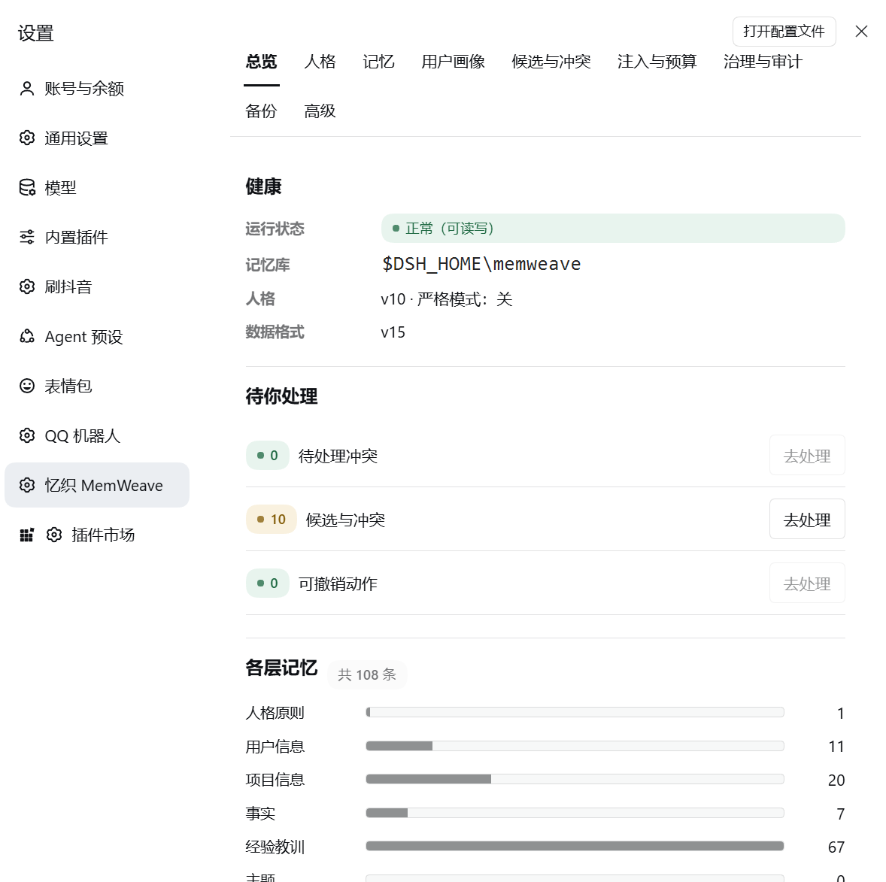
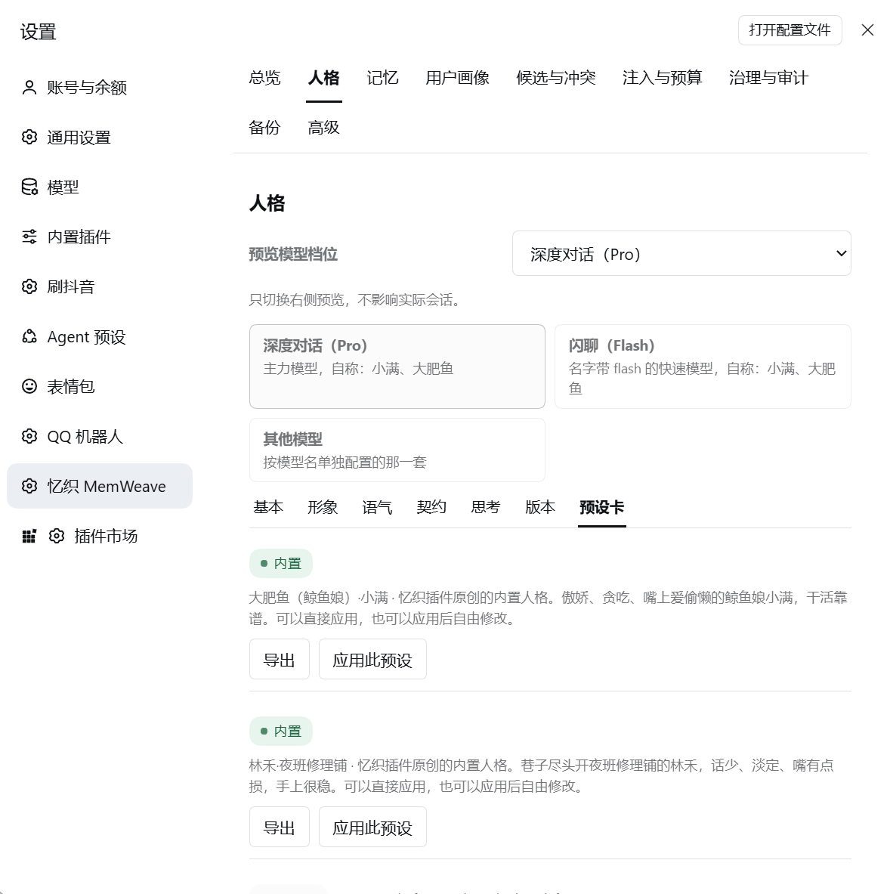
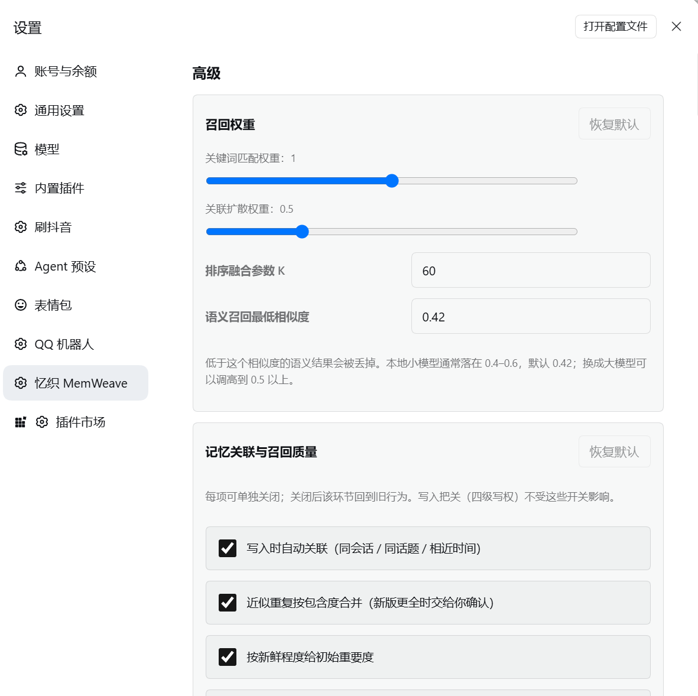

# MemWeave

[中文](./README.zh-CN.md) · English

**v1.0.4** · MIT · Node ≥ 22.13 · a memory and persona plugin for [DeepSeek Harness](https://github.com/deepseek-ai/deepseek-harness)

MemWeave is what gives DSH a memory. Install it once, and the AI remembers who you are, what you are working on, the mistakes it has made, and the promises it made to you. A new session no longer starts from zero.

## Screenshots

<p align="center">
  
  
  
</p>

## Highlights

- **Only what the turn needs**: injection is capped per section, so a bigger memory store does not mean a bigger prompt.
- **Forgetting that feels human**: rarely used memories fade in ranking, frequently used ones stay sharp, and facts about you never retire.
- **You stay in control**: the AI can propose memories; editing the persona, changing rules, resolving conflicts and permanent deletion are human-only.
- **Mistakes are reversible**: writes, edits, merges and consolidation can be undone within 24 hours, all with an audit trail.
- **Nothing gets written blindly**: secrets are blocked, duplicates merge, contradictions freeze until you decide.
- **Promises and dates**: due promises, birthdays, anniversaries and lunar festivals surface ahead of time.
- **Local by default**: one SQLite file, no uploads, no account, and no external service unless you configure an embedding provider; backup is one click and can be encrypted.
- **Works after install**: zero runtime dependencies — the package ships the sqlite-vec extension for five platforms, the local inference runtime (transformers + onnxruntime) and vectra; about 70 MB. Model weights download on first use.

## How it works

### Forgetting, without losing data

Ranking changes; nothing is deleted.

- **Half-life per layer**: topics 30 days, facts 90 days, projects 180 days, facts about you and lessons 365 days, rules never decay.
- **Use reinforces**: memories that keep getting hit can extend their half-life up to 8×.
- **No echo chamber**: a memory recalled over and over in a short window is ranked down to make room for others.
- **Tidying up**: long-unused scattered memories are merged into a summary, projects finished six months ago are archived, and every original can be recovered.

### What must never be forgotten

- **Who you are**: preferences, habits, identity, rules and relationships go into every session start and are never archived.
- **Live projects**: while a project is active, none of its agreements are archived.
- **Pending promises and anniversaries**: kept until the day arrives, then surfaced.

### How recall works

```
FTS5 prefilter → keyword (BM25) + semantic + link expansion → RRF fusion
              → time decay (with floor) → diversity → rumination damping → top-k
```

Every hit carries its reason and decay factor, visible in the UI. The semantic route needs the vector switch (UI **Advanced**) plus an embedding provider; without one, recall stays keyword-only. On startup MemWeave only probes Ollama / LM Studio on local `127.0.0.1`, which `MEMWEAVE_EMBEDDING_DISCOVERY=0` disables entirely. Vector backends are layered as `sqlite-vec → vectra → builtin`, and any failure falls back to keyword recall instead of breaking retrieval.

## Installation

DSH is required. You do not need a separate Node.js — DSH brings its own (Node ≥ 22.13).

```bash
dsh plugin --profile desktop add https://github.com/QuaonY/dsh-mem-weave/releases/download/v1.0.4/dsh-mem-weave-1.0.4.tgz
```

`--profile` is the profile you use — usually `desktop` for the desktop app, `web` for the web app. If you already downloaded the tgz, pass the path instead:

```bash
dsh plugin --profile desktop add file:<full path to the tgz>
```

Restart DSH afterwards; the default configuration works out of the box. To uninstall, replace `add` with `remove dsh-mem-weave`.

The repository is also mirrored on CNB: <https://cnb.cool/QuaonY/dsh-mem-weave>.

The memory database lives at `$DSH_HOME/memweave/memweave.db` by default and can be moved via **Backup → Storage location** in the UI.

## Usage

- **Nine pages**: Overview, Persona, Memory, User Profile, Candidates & conflicts, Injection & budget, Governance & audit, Backup, Advanced. After each turn, a small card reports what was remembered.
- **Two original personas**: Xiaoman (tsundere, talkative) and Lin He · Night-Shift Repair Shop (quiet, terse). Editable, previewable, versioned, and replaceable with presets.
- **22 `weave_*` tools** for writing, recalling, consolidating, governance and profiles; anything touching persona, rules or adjudication is read-only or rejected.
- **In-conversation commands**: `/weave status | reload | preset <id> | strict on|off | dream`, costing no tokens.
- **Configuration**: plugin settings in `$DSH_HOME/config.json`; every key has a safe default.

UI walkthrough, the common config keys, environment variables, tool details and FAQ: [docs/USAGE.md](./docs/USAGE.md). Layers and injection internals: [docs/ARCHITECTURE.md](./docs/ARCHITECTURE.md).

## Security and privacy

- Writes, adjudication and settings are human-only in the UI; AI calls always run as `agent` and get `E_PERM` when they overreach.
- This boundary relies on the host preventing the AI or other plugins from calling this plugin's remote interface directly.
- Credentials are blocked on write; eight kinds of sensitive data (phone, email, ID card, credit card, secrets, IP, address, …) are masked field-by-field before injection and never enter the vector index.
- Database, log and mirror locations can only be changed in the configuration file, not through the UI or remote calls.
- Injected text strips special brackets and newlines to prevent forged sections; logs never contain memory bodies.
- Backups can be encrypted (AES-256-GCM + scrypt); tampering or a wrong passphrase fails immediately.

Details and known limits: [docs/PRIVACY.md](./docs/PRIVACY.md).

## Development

```bash
pnpm install
pnpm build          # build lib/ (includes lib/native and lib/vendor)
pnpm typecheck
pnpm test:coverage  # tests with the coverage gate
pnpm test:scale     # scale benchmark (1k / 10k, needs local datasets)
pnpm conformance    # factory-state zero-injection self-check
pnpm bench:guard    # retrieval guardrails (needs local datasets)
pnpm weave status   # command-line operations
npm pack            # build a local tgz
```

| Directory | Contents |
| --- | --- |
| `src/core` | Rendering, tokenization, scoring, calendar |
| `src/store` | Database, write governance, retrieval, consolidation, backup |
| `src/host` | Plugin entry, service, AI tools |
| `src/client` | UI |
| `src/privacy` | Sensitive detection and redaction |
| `src/presets` | Built-in personas |
| `test` | Tests and recall benchmarks (benchmark suite in `test/bench`) |

Bundled dependency versions are pinned in `scripts/vendor-pins.mjs`. Releases run through `.github/workflows/release.yml`, and the tag must match the `package.json` version.

## Documentation

| Document | Contents |
| --- | --- |
| [docs/USAGE.md](./docs/USAGE.md) | Install, common config keys, env vars, UI, tools, CLI, FAQ |
| [docs/ARCHITECTURE.md](./docs/ARCHITECTURE.md) | Layers, three-section injection, recall pipeline, write governance, data layout |
| [docs/PRIVACY.md](./docs/PRIVACY.md) | Sensitive data handling, permission boundary, encrypted backup, known limits |
| [CHANGELOG.md](./CHANGELOG.md) | Release notes per published version (release bodies are extracted from it) |
| [THIRD_PARTY_NOTICES.md](./THIRD_PARTY_NOTICES.md) | Third-party components and licenses |

## Links

- **DeepSeek Harness (official)** — <https://github.com/deepseek-ai/deepseek-harness>
- **This project** — [GitHub](https://github.com/QuaonY/dsh-mem-weave) · [CNB mirror](https://cnb.cool/QuaonY/dsh-mem-weave)
- **Issues** — <https://github.com/QuaonY/dsh-mem-weave/issues>
- **Author** — Quaon

## License

[MIT](./LICENSE) © 2026 Quaon
