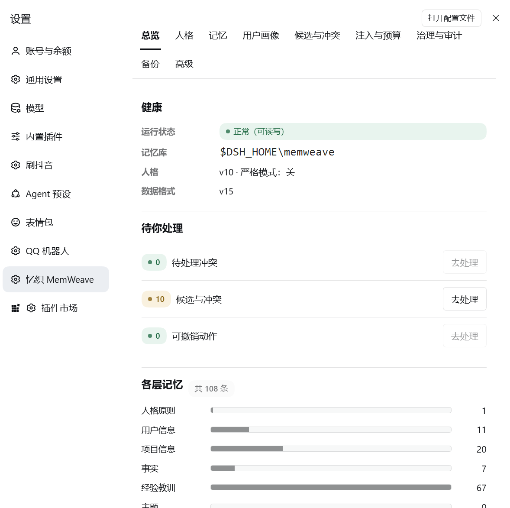
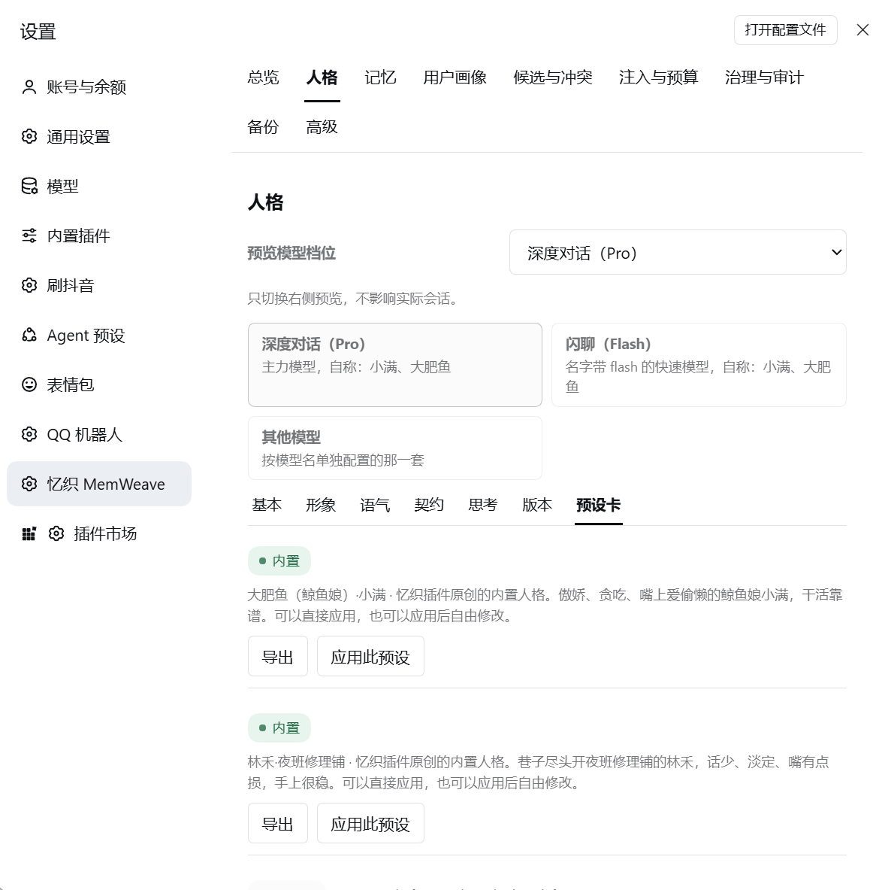
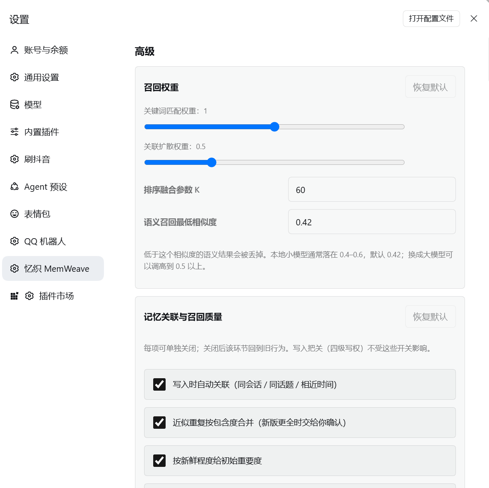

# 忆织 MemWeave

中文 · [English](./README.md)

**v1.0.4** · MIT · Node ≥ 22.13 · 面向 [DeepSeek Harness](https://github.com/deepseek-ai/deepseek-harness) 的记忆与人格插件

忆织是给 DSH 装上记忆的插件。装一次，AI 就会记住你是谁、你们在做什么项目、它踩过什么坑、答应过你什么事。开新会话不用重新认识你。

## 界面截图

<p align="center">
  
  
  
</p>

## 亮点

- **每轮只带用得上的记忆**：注入按段设上限，记忆库变大也不会线性增长。
- **像人一样遗忘**：不常用的慢慢淡出，常用的越记越牢，你本人的信息永远不会忘。
- **你说了算**：AI 只能写记忆、提建议；改人格、改规则、处理冲突、永久删除只能由你来做。
- **改错能撤销**：写入、修改、合并、整理都能在 24 小时内一键撤回，全程有审计记录。
- **不乱记**：密钥、令牌、密码直接拦下；重复的自动合并；互相矛盾的先冻结，等你判断。
- **记得约定和日子**：到期的约定、生日、纪念日、农历节日会提前想起来。
- **数据在本机**：一个 SQLite 文件，不上传、不要账号，默认不连外部服务（除非你自己配置 embedding 服务）；可一键备份，可选加密。
- **装完即用**：没有运行时依赖。包内自带五平台的 sqlite-vec 扩展、本地模型推理组件（transformers + onnxruntime）与 vectra，安装包约 70 MB；模型权重首次使用时才下载。

## 它是怎么做到的

### 像人一样遗忘

遗忘只影响记忆排第几，不删数据。

- **会淡忘**：按层设半衰期——话题 30 天、事实 90 天、项目 180 天、你本人的信息与教训 365 天、规则不衰减。
- **越用越牢**：经常命中的记忆，半衰期最多延长到 8 倍。
- **不翻来覆去**：短时间内反复命中会被降权，给别的记忆让位置。
- **会收拾**：长期不用的零散记忆合并成摘要；完工半年的项目整体收起；原文都能找回。

### 该记住的不会忘

- **你是谁**：偏好、习惯、身份、规则、关系每次开会话都带上，永远不会被收起。
- **在做的项目**：只要项目还在推进，它的约定一条都不会被收起。
- **没到期的约定和纪念日**：一直保留，到日子就会想起。

### 检索怎么做的

```
FTS5 前置候选 → 关键词(BM25) + 语义 + 链接扩展 → RRF 融合
             → 时间衰减（带下限）→ 去同质 → 反刍抑制 → top-k
```

每条结果带命中原因与衰减系数，界面里能看；语义路需要在界面「高级」开启向量开关并配置 embedding 服务，没配置时只走关键词。启动时只会探测本机 `127.0.0.1` 上的 Ollama / LM Studio，设 `MEMWEAVE_EMBEDDING_DISCOVERY=0` 可完全关闭。向量后端按 `sqlite-vec → vectra → builtin` 分层，任一环失败都退回关键词，不会让检索不可用。

## 安装

需要 DSH；不用另装 Node.js，DSH 自带的即可（要求 Node ≥ 22.13）。

```bash
dsh plugin --profile desktop add https://github.com/QuaonY/dsh-mem-weave/releases/download/v1.0.4/dsh-mem-weave-1.0.4.tgz
```

`--profile` 填你在用的 profile，桌面端一般是 `desktop`，网页版是 `web`。tgz 已下载到本地时可以直接给路径：

```bash
dsh plugin --profile desktop add file:<tgz 的完整路径>
```

装完重启 DSH，默认配置就能用。卸载把 `add` 换成 `remove dsh-mem-weave`。

仓库同时镜像在 CNB：<https://cnb.cool/QuaonY/dsh-mem-weave>。

记忆库默认在 `$DSH_HOME/memweave/memweave.db`，可以在界面「备份 → 存储位置」迁移。

## 用起来

- **九个页面**：总览、人格、记忆、用户画像、候选与冲突、注入与预算、治理与审计、备份、高级；每轮对话结束后会提示这轮记了什么。
- **两套原创人格**：小满（傲娇、话多）、林禾·夜班修理铺（安静、话少）。人格可编辑、可预览、可回滚，也能应用预设。
- **22 个 `weave_*` 工具**：覆盖写入、检索、整理、治理、人格与画像；涉及人格、规则与裁决的操作只读或直接拒绝。
- **对话内命令**：`/weave status | reload | preset <id> | strict on|off | dream`，不消耗 token。
- **配置**：写在 `$DSH_HOME/config.json` 的插件配置里，全部键可缺省。

界面用法、常用配置键、环境变量、工具说明与常见问题见 [docs/USAGE.md](./docs/USAGE.md)；分层与注入机制见 [docs/ARCHITECTURE.md](./docs/ARCHITECTURE.md)。

## 安全与隐私

- 界面里的写入、裁决、设置操作只允许人来做；AI 调用固定以 `agent` 身份执行，越权返回 `E_PERM`。
- 这条限制依赖宿主不让 AI 或其他插件直接调用本插件的远程接口。
- 密钥、令牌、密码写入即拦；手机号、邮箱、身份证等八类敏感信息默认字段级脱敏后才进入注入，且不进向量索引。
- 数据库、日志、镜像目录只能在配置文件里改，界面与远程调用改不了。
- 注入前清理特殊括号与换行，防止伪造段落；日志不记录记忆正文。
- 备份可加密（AES-256-GCM + scrypt），篡改或口令错误直接失败。

细节与已知边界见 [docs/PRIVACY.md](./docs/PRIVACY.md)。

## 开发

```bash
pnpm install
pnpm build          # 构建 lib/（含 lib/native、lib/vendor）
pnpm typecheck
pnpm test:coverage  # 带覆盖率门禁
pnpm test:scale     # 规模基准（1k / 10k，需本地数据集）
pnpm conformance    # 出厂状态零注入自检
pnpm bench:guard    # 检索指标护栏（需本地数据集）
pnpm weave status   # 命令行运维
npm pack            # 打本地 tgz
```

| 目录 | 内容 |
| --- | --- |
| `src/core` | 渲染、分词、打分、日历 |
| `src/store` | 数据库、写入把关、检索、整理、备份 |
| `src/host` | 插件入口、服务、AI 工具 |
| `src/client` | 界面 |
| `src/privacy` | 敏感检测与脱敏 |
| `src/presets` | 内置人格 |
| `test` | 测试与召回基准（基准套件在 `test/bench`） |

随包依赖的版本固定在 `scripts/vendor-pins.mjs`；发布由 `.github/workflows/release.yml` 完成，tag 必须与 `package.json` 的版本一致。

## 文档

| 文档 | 内容 |
| --- | --- |
| [docs/USAGE.md](./docs/USAGE.md) | 安装、常用配置键、环境变量、界面、工具、命令行、常见问题 |
| [docs/ARCHITECTURE.md](./docs/ARCHITECTURE.md) | 分层、三段注入、检索流水线、写入治理、整理与数据存放 |
| [docs/PRIVACY.md](./docs/PRIVACY.md) | 敏感信息处理、权限边界、备份加密、已知边界 |
| [CHANGELOG.md](./CHANGELOG.md) | 各已发布版本说明（发布正文取自对应版本段） |
| [THIRD_PARTY_NOTICES.md](./THIRD_PARTY_NOTICES.md) | 第三方组件与许可证 |

## 相关链接

- **DeepSeek Harness 官方** — <https://github.com/deepseek-ai/deepseek-harness>
- **本项目** — [GitHub](https://github.com/QuaonY/dsh-mem-weave) · [CNB 镜像](https://cnb.cool/QuaonY/dsh-mem-weave)
- **问题反馈** — <https://github.com/QuaonY/dsh-mem-weave/issues>
- **作者** — Quaon

## 许可

[MIT](./LICENSE) © 2026 Quaon
